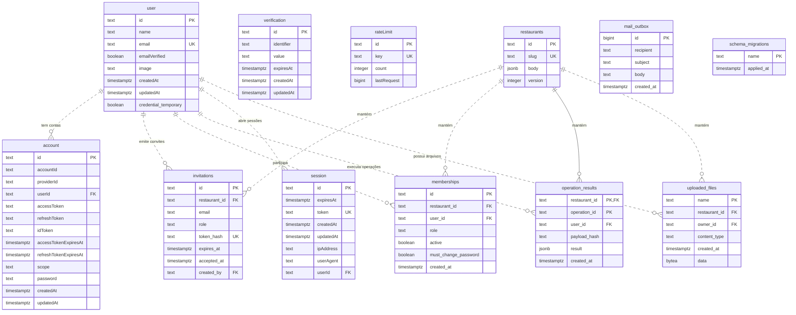
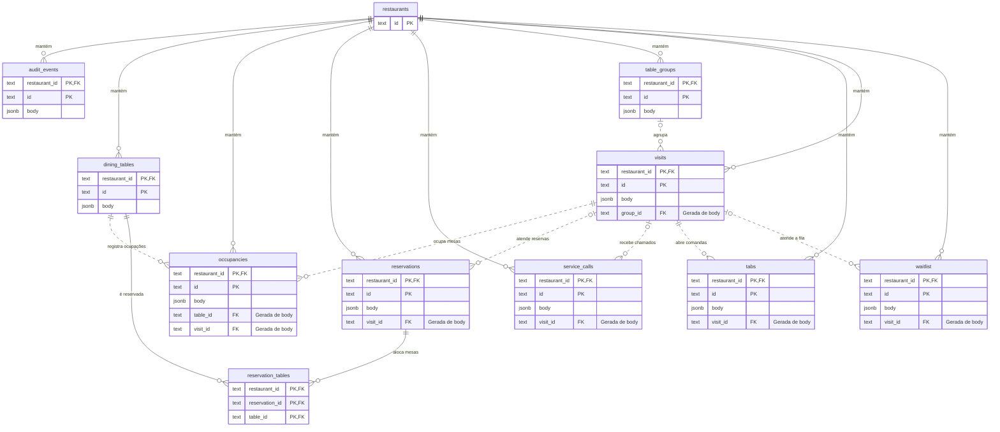
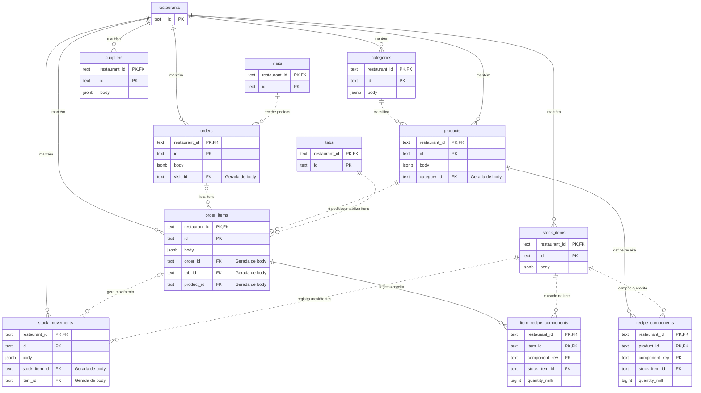
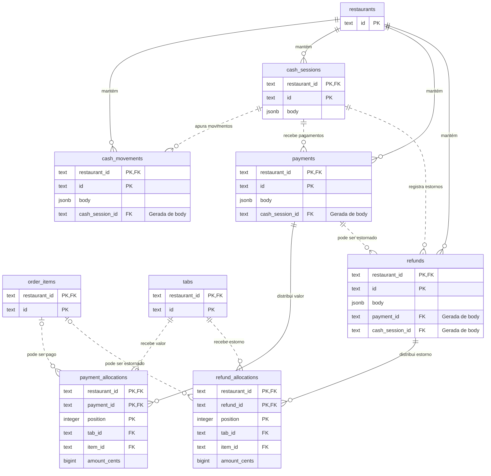

# DER físico do Tavo

[Abrir o diagrama em imagem (SVG)](DER.svg) · [Baixar o arquivo para o dbdiagram (DBML)](DER.dbml)

O diagrama representa as 37 tabelas e as 60 chaves estrangeiras do PostgreSQL. As entidades que participam de mais de uma área aparecem também com seus identificadores nas áreas relacionadas.

- **PK** indica chave primária, **FK** indica chave estrangeira e **UK** indica uma coluna com restrição única própria. Colunas marcadas como PK na mesma tabela compõem a chave primária em conjunto.
- As referências compostas incluem `restaurant_id` para vincular registros do mesmo restaurante. Colunas marcadas como geradas extraem seus valores do `body` JSONB.
- Linhas contínuas indicam FKs que integram a PK da tabela filha. Linhas tracejadas indicam FKs fora da PK ou que a integram apenas em parte. A cardinalidade expressa o que as restrições SQL permitem.

As definições completas, incluindo índices e restrições, estão nas [migrações](../migrations) e no [executor de migrações](../../scripts/database/migrate.ts).

## Autenticação, acesso e infraestrutura

## Salão e atendimento

## Cardápio, estoque e pedidos

## Caixa, recebimentos e estornos

